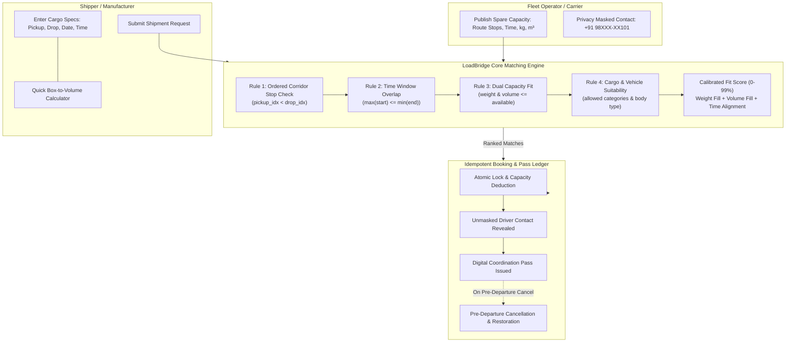

# LoadBridge — Local Truck-Load & Spare-Capacity Matching Platform

[](https://www.python.org/)
[](https://fastapi.tiangolo.com/)
[](https://pytest.org/)
[](https://en.wikipedia.org/wiki/Mumbai%E2%80%93Pune_Expressway)
[](LICENSE)

> **LoadBridge** is an industrial-grade freight capacity matching engine and coordination platform tailored for intra-corridor logistics (specifically targeting the high-density **Pune — Mumbai Industrial Highway Corridor**). It enables small and medium businesses (SMBs) and manufacturers to match partial truckloads into spare truck weight and volume capacity along active transit routes.

---

## 🌟 Key Capabilities & Highlights

1. **Deterministic 4-Rule Matching Engine**: Zero hallucination, strict mathematical and operational evaluation of ordered corridor stops, time overlap, dual capacity (weight & volume), and cargo-body compatibility.
2. **Calibrated Fit-Score (0–99%)**: Transparent scoring formula factoring capacity utilization efficiency (weight fill ratio and volume fill ratio), time window overlap, and corridor hop directness.
3. **Dual Weight & Volume Space Optimization**: Prevents trucks from "weighing out" or "cubing out" prematurely.
4. **Interactive Box-to-Volume Calculator**: Converts industrial carton quantities and dimensions into cubic meters ($m^3$) and kilograms ($kg$) in real time.
5. **Idempotent Booking & Capacity Deductions**: Concurrency-safe atomic capacity deductions that prevent double-booking or over-allocation.
6. **Privacy-Preserving Digital Coordination Pass**: Transporter and driver contact numbers are masked until booking confirmation. Upon booking, an unmasked coordination pass with a unique verification code and loading dock pass is generated.
7. **Pre-Departure Cancellation Protection**: Restores cargo weight and volume back to the carrier’s pool if a shipment is cancelled prior to departure.

---

## 🏗️ System Architecture



---

## 📐 The 4-Rule Matching Engine Explained

| Rule | Operational Rule Name | Logic & Mathematical Condition | Why It Matters in Real Logistics |
| :--- | :--- | :--- | :--- |
| **Rule 1** | **Ordered Corridor Sequence** | `pickup_index < drop_index` in `truck.route_stops` | Rejects reverse routes (e.g. Panvel &rarr; Pimpri on a Pune &rarr; Mumbai truck) and ensures stops belong to the truck's forward path. |
| **Rule 2** | **Date & Time Overlap** | `truck.date == req.date` AND $\max(t_{\text{start}}, r_{\text{start}}) < \min(t_{\text{end}}, r_{\text{end}})$ | Ensures both carrier and shipper operate on the same calendar day with a mutually viable transit overlap window. |
| **Rule 3** | **Dual Capacity Fit** | `req.weight <= truck.available_weight` AND `req.volume <= truck.available_volume` | Real freight has independent weight limits and volumetric cubing limits. Both must be satisfied simultaneously. |
| **Rule 4** | **Vehicle & Cargo Suitability** | `req.cargo_type in truck.allowed_cargo` AND vehicle body compatibility | Prevents contamination (e.g. food with chemicals) and guarantees appropriate equipment (e.g. Closed Container for weather-sensitive parts). |

### Calibrated Fit-Score Formula (0 – 99%)
If any of the 4 hard operational rules fail, the match is marked **incompatible** (`Fit Score = 0%`). When all 4 rules pass:

$$\text{Fit Score} = \min\left(99, \text{round}\left(45 + S_{\text{weight}} + S_{\text{volume}} + S_{\text{time}} + S_{\text{route}}\right)\right)$$

Where:
- $S_{\text{weight}} = \frac{\text{req.weight}}{\text{truck.available\_weight}} \times 24$ (rewards high payload utilization)
- $S_{\text{volume}} = \frac{\text{req.volume}}{\text{truck.available\_volume}} \times 20$ (rewards high cubic fill)
- $S_{\text{time}} = \frac{\text{overlap\_mins}}{\text{req\_duration\_mins}} \times 6$ (rewards generous operational alignment)
- $S_{\text{route}} = \text{directness factor} \times 4$ (slight bonus for direct corridor segments)

---

## 🛣️ Pre-Seeded Pune — Mumbai Corridor Data

The platform comes pre-seeded with realistic industrial corridor data along National Highway 48 (NH-48):

* **Truck TRK-101** (*Shinde Transport*):
  - **Vehicle**: 14ft Closed Container
  - **Corridor Stops**: `Pune` &rarr; `Pimpri` &rarr; `Lonavala` &rarr; `Panvel` &rarr; `Mumbai`
  - **Schedule**: `2026-10-20` (09:00 – 11:00)
  - **Capacity Available**: `1,200 kg` / `8.0 m³` (Total: `2,500 kg` / `14.0 m³`)
  - **Allowed Cargo**: Auto Parts, Dry Cartons, Textiles
  - **Masked Phone**: `+91 98XXX-XX101` | **Full Phone**: `+91 98230-44101`

* **Truck TRK-108** (*Deshmukh Logistics*):
  - **Vehicle**: 17ft Closed Container
  - **Corridor Stops**: `Chakan` &rarr; `Pimpri` &rarr; `Panvel` &rarr; `Vashi`
  - **Schedule**: `2026-10-20` (10:00 – 12:00)
  - **Capacity Available**: `750 kg` / `5.0 m³` (Total: `3,500 kg` / `18.0 m³`)
  - **Allowed Cargo**: Auto Parts, Dry Cartons
  - **Masked Phone**: `+91 98XXX-XX108` | **Full Phone**: `+91 98230-77108`

* **Sample Open Request REQ-01** (*Pimpri Auto Spares*):
  - **Route**: `Pimpri` &rarr; `Panvel`
  - **Schedule**: `2026-10-20` (08:00 – 10:30)
  - **Cargo**: `600 kg` / `3.5 m³` of Auto Parts (Requires Closed Container)

---

## 🚀 Quick Start Guide

### Prerequisites
- Python 3.10+ (Python 3.11 recommended)
- `pip` or [`uv`](https://github.com/astral-sh/uv)

### 1. Clone & Set Up Virtual Environment

```bash
# Clone the repository
git clone https://github.com/your-username/loadbridge-platform.git
cd loadbridge-platform

# Create virtual environment
python -m venv .venv

# Activate on Windows (PowerShell)
.venv\Scripts\activate

# Activate on Linux / macOS
source .venv/bin/activate
```

### 2. Install Dependencies

```bash
pip install -r requirements.txt
```

*(Or via uv: `uv pip install -r requirements.txt`)*

### 3. Run the Automated Test Suite

```bash
pytest -v
```

All 19 test cases verify:
- Ordered corridor checks & reverse route rejection
- Time interval overlap calculation
- Dual weight & volume deficits
- Cargo category & vehicle body compatibility
- Strict input validation guards
- Idempotency and atomic capacity deduction
- Pre-departure cancellation capacity restoration
- REST API integration

### 4. Start the Application Server

```bash
uvicorn app.main:app --host 127.0.0.1 --port 8000 --reload
```

Open your browser at:
- **Interactive Web App**: [http://127.0.0.1:8000](http://127.0.0.1:8000)
- **FastAPI Interactive Swagger Docs**: [http://127.0.0.1:8000/docs](http://127.0.0.1:8000/docs)
- **ReDoc Documentation**: [http://127.0.0.1:8000/redoc](http://127.0.0.1:8000/redoc)

---

## 🖥️ Interactive Web UI Prototype Views

1. **Role Switcher Header**: Instantly navigate between Transporter, Shipper, Matches, and Pass Ledger views with real-time corridor indicators.
2. **Dashboard & Fleet Capacity Ledger**: Visual cards with dual progress bars for Weight and Volume utilization, directional corridor sequence arrows, and capacity telemetry.
3. **Shipper Portal & Quick Box-to-Volume Calculator**: Allows shippers to enter carton counts and pick standard box sizes (Auto Spares, FMCG, Textiles, or Custom Dimensions) to compute exact volume in $m^3$ and weight in $kg$ with 1-click form application.
4. **Transporter Capacity Publishing**: Form with dynamic stop chips, ordered corridor sequence builder, time window pickers, and multi-category cargo filters.
5. **Ranked Matches View**: Dynamic compatibility cards featuring Fit Score (0-99%), 4 explicit rule badges with tooltips, before/after capacity previews, and 1-click booking.
6. **Digital Coordination Pass & Cancel Protection**: Generates an official printable pass with unmasked driver contact, verification hash code, and a pre-departure cancellation button that restores capacity instantly.

---

## 📡 REST API Reference

| Method | Endpoint | Description |
| :--- | :--- | :--- |
| `GET` | `/` | Serves the LoadBridge Single-Page Application |
| `GET` | `/api/trucks` | List all active corridor truck capacity listings |
| `POST` | `/api/trucks` | Publish new spare truck capacity with ordered stops |
| `GET` | `/api/trucks/{truck_id}` | Retrieve truck specification by ID |
| `GET` | `/api/requests` | List all open and booked shipment requests |
| `POST` | `/api/requests` | Submit a new shipment cargo request |
| `GET` | `/api/matches/{request_id}` | Execute 4-rule matching engine and get ranked trucks |
| `POST` | `/api/bookings/confirm` | Idempotently confirm booking & issue Coordination Pass |
| `POST` | `/api/bookings/{id}/cancel` | Pre-departure cancel & atomically restore truck capacity |
| `GET` | `/api/bookings` | Retrieve full Coordination Pass ledger |
| `GET` | `/api/stats` | Corridor telemetry & capacity utilization percentages |

---

## 📂 Project Structure

```
loadbridge-platform/
├── .gitignore               # Clean gitignore excluding venvs, pycache, db
├── requirements.txt         # Core dependencies (FastAPI, Uvicorn, Pydantic, Pytest, HTTPX)
├── pytest.ini               # Pytest configuration with pythonpath set
├── README.md                # Complete portfolio documentation
├── app/
│   ├── __init__.py
│   ├── main.py              # FastAPI server, REST routes & static mounts
│   ├── matching_engine.py   # 4-Rule Engine, calibrated scoring & thread-safe state
│   └── static/
│       └── index.html       # Single-Page App with Tailwind CSS & 6 prototype views
└── tests/
    ├── __init__.py
    └── test_loadbridge.py   # 19 comprehensive unit & integration tests
```

---

## 🛡️ License

This project is licensed under the [MIT License](LICENSE).
